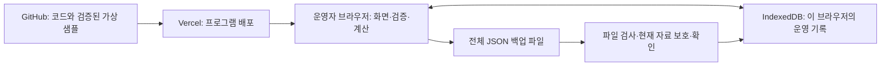

# 프렙 카페 운영 프로그램 기술 요구사항 문서(TRD)

작성일: 2026-10-12  
상태: 기술 설계 완료. 사용자의 ‘TRD문서는 추천대로 하고 완료해줘’에 따라 아래 기술 선택을 채택했다. 코드 구현·검사·GitHub 등록·Vercel 배포는 아직 수행하지 않았다.

## 1. 목적과 기준 문서

TRD는 프로그램을 어떤 기술로 만들고, 기록을 어디에 저장하며, 오류와 배포를 어떻게 처리할지 정하는 문서다. 기능과 업무 기준은 `docs/01_PRD.md`, `docs/02_FRD.md`를 따른다. `design/_1`, `_2`, `_3`의 HTML·화면 이미지와 `design/artisan_operational_ledger/DESIGN.md`는 시각적 참고 자료다. 시안의 고정 숫자·예시 동작은 실제 프로그램의 처리 기준으로 사용하지 않는다.

1차는 한 매장·한 운영자·한 기기의 판매 입력 → 메뉴 수익성 → 매장 손익 → 재료 잔량 확인, 지속 저장·전체 백업·복원이다. 판매와 비용의 입력·수정·삭제, 재료 입고·폐기·하루 종료 실측, 일·월 조회를 빠짐없이 구현한다. FRD F01~F15, C01~C06, Q01~Q08을 변경하지 않는다.

엑셀 양식·가져오기, 주·분기·반기·연간 조회, 예상 손익, 부족 재료 판정·발주량, 메뉴·가격·레시피 편집, 재고 수정·삭제, 자동 백업·공동 사용은 2차다. 시안에 있는 CSV 내보내기, POS 연동, 일괄 삭제, 설정·계정, 자동 등급·목표·전기 비교·수동 마감 버튼을 1차에 추가하지 않는다.

### 확인된 사실과 이번 설계 결정

| 구분 | 내용 |
| --- | --- |
| 자료에서 확인한 사실 | 가상 프렙 카페 샘플, 메뉴 8개·재료 11개·레시피 22개, 판매 6,112건·비용 3,560건·재고 기록 1,515건. JSON 약 3.46MB. 실적은 2025-07-01~2026-09-18, 이후 달력은 미마감 |
| PRD·FRD에서 확정한 내용 | 한 운영자 사용, 직접 입력 우선, 과거 원가 유지, 실측 이후 잔량 기준, JSON 전체 백업·전체 대체 복원, 새 기록·변경 날짜의 잠정 표시 |
| 이번에 채택한 기술 결정 | React·TypeScript·Vite, 브라우저 IndexedDB 저장, Dexie·Zod·decimal.js, GitHub 비공개 코드 저장소, Vercel 정적 웹 배포 |
| 운영 시 확인할 실제 값 | 실제 구매가격·결제수수료·누락 기록, 사용할 GitHub 저장소 주소·Vercel 프로젝트 및 운영 주소. 값을 임의로 만들지 않는다 |

## 2. 전체 구성과 쉬운 설명

프로그램 파일은 Vercel에서 내려받고, 계산과 운영 기록 저장은 운영자의 브라우저에서 처리한다. 별도 데이터 서버를 만들지 않아 개발 시간과 운영 부담을 줄인다. GitHub에는 소스 코드를 보관한다. GitHub와 Vercel에 저장된 코드가 운영자의 입력 기록을 백업하는 것은 아니다.

| 용어 | 비개발자를 위한 설명 |
| --- | --- |
| 정적 웹 배포 | 완성된 프로그램 파일을 웹주소로 제공한다. 기록 처리용 서버는 별도로 두지 않는다 |
| IndexedDB | 브라우저 안에 여러 종류의 기록을 저장하는 저장소다. 창을 닫았다 열어도 남도록 사용한다 |
| 트랜잭션 | 여러 기록을 모두 저장하거나 모두 취소하는 묶음 처리다. 복원 중 절반만 바뀌는 일을 막는다 |
| 스키마·버전 | 저장 항목의 구조와 그 구조의 번호다. 파일을 서로 읽을 수 있는지 판단한다 |
| 스냅샷 | 판매 당시의 개당 원가처럼 그때의 값을 따로 보존한 기록이다 |
| 자동 검사 | 프로그램이 바뀔 때 계산과 저장 동작을 다시 확인하는 검사다 |

운영 환경은 Windows의 일반 모드 Chrome 또는 Edge 최신 안정 버전 중 운영자가 정한 한 브라우저·한 프로필·하나의 운영 주소다. 비공개 모드는 지속 저장 용도로 사용하지 않는다. 같은 컴퓨터라도 다른 브라우저·프로필·주소는 별도 기록을 가진다. 휴대폰·다른 기기와 자동 공유되지 않는다. 설치형 앱·오프라인 실행 보장은 1차에 포함하지 않는다.

## 3. 기술 선택과 개발 구조

| 영역 | 채택 기술 | 선택 이유와 사용 범위 |
| --- | --- | --- |
| 화면 | React + TypeScript | 입력 상태·목록·결과를 함께 갱신한다. TypeScript는 금액과 수량 같은 항목을 잘못 연결하는 실수를 개발 중 확인한다 |
| 개발·배포 파일 생성 | Vite | 브라우저에서 실행할 파일을 생성한다. `npm run build` 결과 `dist`를 배포한다. [Vite 배포 안내](https://vite.dev/guide/static-deploy) |
| 실행 도구 | Node.js 24.x + npm | 개발·검사·빌드에만 사용한다. 운영자에게 설치를 요구하지 않는다. Vercel에서도 동일한 24.x를 사용한다. [Vercel 지원 Node.js 버전](https://vercel.com/docs/functions/runtimes/node-js/node-js-versions) |
| 스타일 | Tailwind CSS의 Vite 빌드 방식 + CSS 변수 | 시안의 색·간격을 재사용하되 외부 CDN 스크립트 없이 CSS 파일을 만든다. [공식 설치 안내](https://tailwindcss.com/docs/installation/using-vite) |
| 저장 | IndexedDB + Dexie | 현재 자료 규모에 적합한 로컬 기록 저장과 원자적 처리를 제공한다. [Dexie 트랜잭션 안내](https://dexie.org/docs/Dexie/Dexie.transaction()) |
| 입력·파일 검사 | Zod | 입력창과 복원 파일에 동일한 구조·값 검사를 적용한다. [Zod 공식 문서](https://zod.dev/) |
| 소수 계산 | decimal.js | 원가의 소수와 반올림을 일관되게 처리한다. 40자리 유효숫자, ROUND_HALF_UP을 사용한다. [라이브러리 공식 문서](https://github.com/MikeMcl/decimal.js) |
| 검사 | Vitest, Playwright, ESLint, TypeScript 검사 | 계산·저장 검사와 실제 브라우저의 핵심 흐름 검사를 나눈다 |

라이브러리의 실제 설치 버전은 구현 시작 시 호환되는 안정 버전으로 고정하여 `package-lock.json`에 보관한다. 이후 설치는 `npm ci`를 사용하고 자동으로 최신 버전을 따라가지 않는다. 프레임워크를 여러 개 혼용하거나 별도 서버·클라우드 DB·로그인·분석 서비스·대형 그래프 라이브러리를 추가하지 않는다.

구현 파일은 다음 책임으로 나눈다. 화면이 직접 저장소를 수정하거나 화면마다 다른 계산식을 갖지 않게 한다.

| 경로 | 책임 |
| --- | --- |
| `src/domain/` | 기록 항목, Zod 검사, FRD 업무 기준, C01~C06 계산, 잠정·계산 불가 상태 |
| `src/data/` | Dexie 구조, 최초 자료 변환, 저장·수정·삭제, 백업·복원 |
| `src/features/sales/` | 판매 목록·입력·수정·삭제 |
| `src/features/profit/` | 메뉴 수익성과 비용 구성 |
| `src/features/store/` | 전체 채널 손익과 비용 목록·입력·수정·삭제 |
| `src/features/inventory/` | 재료 잔량·입고·폐기·실측 |
| `src/components/` | 기간 선택·표·입력창·확인창·오류·백업/복원 공통 부품 |
| `public/data/seed.json` | 공개 제공 가능함을 확인한 가상 원자료 JSON 한 벌 |
| `tests/` | 계산·저장·백업 검사와 브라우저 흐름 검사 |
| `docs/`, `vercel.json`, `.github/workflows/` | 요구사항·운영 안내, 배포 헤더, 자동 검사 |

화면 이동은 `/#/sales`, `/#/profit`, `/#/store`, `/#/inventory`의 주소 끝 구분을 사용한다. 새로고침 시 서버가 별도 화면 경로를 찾을 필요가 없어 배포 설정을 줄인다. 기간 상태는 공통으로 유지하고 메뉴·채널·검색 필터는 FRD의 화면별 적용·재진입 초기화 기준을 따른다. 금액·메모·백업 내용을 주소에 넣지 않는다.

## 4. 데이터 구조와 지속 저장

### 4.1 저장 단위

DB 이름은 `prep-cafe-operations`, 첫 구조 버전은 `1`로 한다. 다음은 기술적인 저장 묶음이며 운영자가 관리할 새 화면을 뜻하지 않는다.

| 저장 묶음 | 기본 식별자·검색 기준 | 보존할 내용 |
| --- | --- | --- |
| `appMeta` | 고정 키 `main` | 매장·출처·자료 구분·자료 버전, 최초 반영 완료, DB/업무 기준 버전, 전체 변경 번호 `revision` |
| `suppliers`, `materials`, `menus` | 원자료 ID | 이름·공급사·기준단위·구매용량 등 원래 기준 자료 |
| `recipes` | 메뉴ID·레시피 버전·재료ID·채널 조건 | 원래 메뉴당 사용량. 채널 조건의 빈칸은 모든 채널이라는 의미로 보존 |
| `priceHistory` | 재료ID·적용일 | 같은 행의 구매가격·구매용량·단위. 날짜가 같은 상충 자료를 자동 선택하지 않음 |
| `calendar` | 날짜 | 원래 영업·마감 정보·날씨·메모 |
| `sales` | 판매ID, 날짜, 유일한 날짜·메뉴ID·채널 조합 | 당시 단가·할인·순매출·수수료·레시피 버전·개당 식재료/포장 원가 |
| `expenses` | 비용ID, 날짜·항목 | 날짜별 비용, 기존 배분 기준. 같은 날짜·항목의 실제 별도 비용 허용 |
| `openingInventory` | 재료ID·기준일 | 첫 영업 전 초기재고 |
| `inventoryEvents` | 기록ID, 날짜·재료ID, 실측만 유일한 `countKey` | 입고·폐기·실측, 부호 있는 수량·단위·사유·실측 수량, 기존 공급사·단가 등 원래 필드 |
| `monthlyExpensePlan` | 원래 월·항목 식별 조합 | 원자료 보존만 수행. 비용 합산에 넣지 않음 |
| `workingDates` | 날짜 | 새 입력·변경 후 잠정 상태. 원래 달력의 마감 사실과 분리 |
| `policies` | 고정 키 `rules` | 승인된 단위·비용 분류·하루 종료 실측·과거 원가 유지 등 업무 기준 버전 `1` |
| `sourceIssues` | 문제 식별자 | 최초 자료의 중복 등 정상 저장 구조에 넣을 수 없는 원래 기록과 영향 범위. 오류를 숨기지 않기 위한 보존 영역이며 편집 기능은 없음 |

새 판매·비용·재고 ID는 `crypto.randomUUID()`를 사용하고 원자료 ID는 유지한다. 실측 `countKey`는 `날짜|재료ID`로 두고 다른 재고 기록에는 해당 필드를 넣지 않는다. 판매 복합 인덱스와 실측 인덱스로 중복을 저장 단계에서도 막는다. 비용 중복은 경고 후 확인하는 기준이므로 유일 인덱스를 두지 않는다.

원자료를 정규화할 때 원래 부가 필드·출처 정보를 보존한다. 계산 결과·표 페이지·검색 조건은 운영 원본에 덧씌우지 않는다. 합계와 실측 차이는 메모리에서 재산출하고 `revision`별로 재사용한다. 원래 실측 증감수량과 현재 계산한 차이는 별개다.

### 4.2 날짜·수량·금액

- 업무 날짜는 `YYYY-MM-DD` 문자열이다. 한국 시간 오늘은 `Intl.DateTimeFormat`의 `Asia/Seoul`로 구한다. UTC 변환으로 영업 날짜가 하루 바뀌지 않게 한다. 백업 생성 시각만 UTC ISO 시각으로 기록한다.
- 화면의 빈 입력은 `null` 또는 미입력 상태로 유지한다. 0으로 자동 변환하지 않는다. 입력 원 금액·판매수량·개 수량은 FRD에 따른 정수, g/ml는 소수 셋째 자리까지다.
- 저장하는 금액·원가·수량은 정규화된 십진수 문자열로 통일한다. 계산 시 decimal.js로 변환하며 원자료의 숫자는 유한한 숫자인지 검사 후 변환한다. 표시된 반올림 숫자를 다시 저장하거나 계산에 사용하지 않는다.
- 개당 원가의 원래 소수값은 보존한다. 단위 불일치·연결 누락·같은 적용일의 상충 가격은 검사 대상으로 남기며 이름 유사성으로 자료를 연결하지 않는다.

### 4.3 저장 수명과 여러 창

다시 열 때 DB를 먼저 읽는다. 저장된 자료가 있으면 배포된 샘플보다 우선한다. DB가 손상되거나 읽기 실패한 경우 자동 삭제·초기화를 하지 않는다. 최초 자료 완료 표식이 없지만 일부 저장소에 기록이 남아 있으면 불완전 초기화로 안내하고 덮어쓰지 않는다.

브라우저 저장은 주소의 출처(프로토콜·호스트·포트)와 프로필에 묶인다. 사이트 데이터 삭제·디스크 압박 등으로 사라질 수 있다. `navigator.storage.persist()`를 요청하고 실패해도 저장 보장을 표시하지 않는다. 용량은 `navigator.storage.estimate()`로 확인하되 예상치로 취급한다. [브라우저 저장 한도와 삭제 조건](https://developer.mozilla.org/en-US/docs/Web/API/Storage_API/Storage_quotas_and_eviction_criteria)

같은 운영 주소의 다른 창이 기록을 변경하면 다른 창의 `revision`과 비교한다. 편집 시작 이후 변경되었다면 저장·복원을 거부하고 최신 자료를 다시 읽도록 안내한다. 자동 합치기를 하지 않는다. 이는 한 기기에서 우연히 여러 창을 연 경우의 데이터 보호이며 공동 사용 기능을 추가하는 것이 아니다.

## 5. 최초 자료·입력·수정·삭제 처리

### 5.1 제공 자료 반영(F01)

최초 DB가 완전히 비어 있을 때만 `seed.json`을 한 번 읽는다. 엑셀과 JSON을 함께 합산하지 않으며 엑셀 파서도 1차에 설치하지 않는다. 파일 형식·ID·연결·단위·기간·판매 집계 중복을 검사하고 전체 후보 자료를 준비한 뒤 한 트랜잭션으로 저장한다. 완료 표식도 함께 저장한다. 네트워크·파일 검사·저장 실패 시 완료로 표시하지 않는다.

현재 제공 자료는 정상적인 연결과 유일성을 구현 검사에서 확인해야 한다. 최초 자료에 잘못된 기존 기록이 발견되면 자동 합산·0 보충하지 않는다. 구조적으로 읽을 수 있는 기록과 원래 값을 보존하고 문제 목록을 표시한다. 중복된 조합의 모든 원래 행은 `sourceIssues`에 보존하고 정상 판매 집계에서는 제외하되, 해당 메뉴·기간과 의존하는 전체 이익을 ‘자료 확인 필요’로 표시한다. 임의로 한 행을 정답으로 선택하지 않는다. 필수 기준 자료 연결 누락도 영향을 받는 결과를 계산 불가로 표시한다. JSON 자체를 읽을 수 없는 오류는 초기 반영을 중단한다. 정상 자료 반영 성공과 문제 자료를 보존한 검토 상태를 구분하며, 재접속 시 문제 자료도 샘플로 덮어쓰지 않는다.

### 5.2 공통 저장 순서(F03~F05, F07~F08, F11~F13)

1. 입력을 보존한 상태로 형식·필수값·날짜·연결·중복을 검사한다.
2. 최신 자료와 `revision`을 읽고 변경 후보를 메모리에서 만든다. 휴무 판매·수수료 초과·비용 유사 중복·과다 폐기·날짜/메뉴/채널 수정·삭제·실측은 FRD가 정한 확인을 받는다.
3. 후보에 C01~C06을 적용해 영향받는 결과와 잠정 날짜를 준비한다. 누락값이 있는 결과는 계산 불가 상태와 원인을 함께 만든다.
4. 한 DB 트랜잭션 안에서 변경 번호·유일성을 다시 검사하고 대상 기록·잠정 날짜·변경 번호를 함께 저장한다. 수정은 ID를 유지한다. 삭제는 대상 한 건만 제거한다.
5. 트랜잭션 완료 후 준비한 결과로 모든 연결 화면을 갱신하고 저장 성공을 표시한다. 진행 중 저장 버튼을 잠가 중복 클릭을 막는다.

파일 읽기·사용자 확인·네트워크 요청은 DB 트랜잭션 밖에서 끝낸다. 저장 도중 실패하면 전체 묶음을 취소하고 기존 자료·입력창 내용을 유지한다. 저장 자체가 성공한 뒤 화면 렌더링만 실패했다면 저장 실패로 오인시키지 않고 ‘저장됨, 화면 갱신 필요’를 안내하며 DB를 다시 읽는다.

판매 수정은 수량·단가·할인·수수료만 바뀌면 개당 원가 스냅샷을 유지한다. 날짜·메뉴·채널이 바뀌면 해당 날짜의 원가를 새로 확인하고 전후 값을 보여준 뒤 저장한다. 변경 전후 날짜를 모두 잠정으로 기록하고 해당 기간과 재고를 갱신한다. 다른 판매 스냅샷은 변경하지 않는다. 비용은 손익을 갱신하되 메뉴 직접수익·재료 수량을 변경하지 않는다. 재고는 입고 양수·폐기 음수로 변환하고 실측을 하루 종료 기준으로 저장한다.

## 6. 계산 구현과 화면 반영

계산은 화면과 저장 기술에 의존하지 않는 함수로 구현한다. 모든 표·요약·비용 구성은 같은 결과 객체를 사용한다. 결과는 `정상`, `잠정`, `계산 불가`와 이유·영향 기록 ID를 함께 가진다. 잠정 여부와 계산 가능 여부는 별도 속성이므로 잠정이면서 계산 불가일 수도 있다.

| FRD 기준 | 구현 방법과 반드시 지킬 내용 |
| --- | --- |
| C01 매출 | 새 판매·대상 수정의 순매출은 수량×단가−전체 할인액. 원자료의 저장된 과거 순매출은 보존하고 불일치는 검사로 알린다. 부가세를 다시 빼지 않음 |
| C02 개당 원가 | 판매일 이하의 가장 최근 적용일을 찾는다. 같은 가격 행의 구매가격÷구매용량×레시피 사용량을 모은다. I01~I09 식재료, I10~I11 포장 분리. 채널·레시피 버전 적용 후 스냅샷 저장 |
| C03 메뉴 수익성 | 순매출−수량×당시 개당 식재료 원가−수량×당시 개당 포장 원가−실제 수수료. 전체 마진은 전체 직접수익÷전체 순매출. 메뉴 마진의 평균 금지 |
| C04 매장 손익 | 선택 기간 전체 메뉴·채널의 직접수익−날짜별 운영비 8개 항목. 월비용계획·입고 구매대금·폐기 손실금액·없는 세금 추가 금지 |
| C05 잔량 | 초기재고와 판매·입고·폐기를 날짜별로 집계. 같은 날 이들 합산 후 종료 실측 적용. 최신 실측 이후는 그 실측량에 이후 변동만 반영. 원래 실사조정량 중복 가산 금지 |
| C06 정밀도 | 중간 소수 유지, 최종 금액 정수 원·비율 소수 1자리·개당 원가 소수 2자리·g/ml 소수 3자리 표시. 0.5는 0에서 먼 방향으로 반올림 |

재고 계산은 재료별 날짜 흐름을 한 번 순회한다. 실측 전에 판매를 고치면 당시 장부·계산 차이만 재산출하고 실측량과 원래 조정량은 유지한다. 실측 뒤 잔량은 변경된 이전 장부에 다시 끌려가지 않는다. 가격 누락만 있고 레시피 사용량이 유효하면 재고 수량은 독립적으로 계산한다.

음수 재고·손익은 경고와 실제 계산값으로 표시한다. 순매출 0의 비율, 필수 원가 누락에 의존하는 이익, 초기재고·레시피·실측 수량 누락에 의존하는 잔량은 계산 불가로 표시한다. 알려진 수량·순매출은 따로 표시할 수 있다. 미마감 기록 부재는 실제 0으로 채우지 않는다. 새 날짜·변경 날짜를 확정 마감으로 바꾸지 않는다.

### 화면과 요구사항의 연결

| 기능 | 구현 책임·화면 결과 |
| --- | --- |
| F01 | 자료 반영 상태·가상 샘플·기록 기간·오류 안내 |
| F02 | 일/월 공통 기간, 화면별 메뉴·채널 필터, 재료 검색. 표 20행·최근 날짜/ID 순. 요약은 현재 페이지에 한정하지 않고 전체 조회 범위 집계 |
| F03·F04·F05 | 시안 _1을 판매 화면으로 재구성. 7개 입력과 원가 확인, 행 수정·단일 삭제, 확인·취소·저장 중 상태 |
| F06 | 시안 _2의 표와 비용 구성 재사용. 실제 계산값·조회 범위·잠정/계산 불가 표시 |
| F07·F08·F09 | 시안에 빠진 매장 손익 화면 보완. 전체 채널 집계와 운영비 8항목, 비용 목록 및 입력·수정·삭제 |
| F10·F11·F12 | 시안 _3의 잔량 표와 입고·폐기·실측 입력. 종료일 잔량, 최신 실측 날짜·그때 차이·음수 경고 |
| F13 | DB 완료 이후 성공 표시, 재접속 복구, 저장 실패 시 입력 유지 |
| F14·F15 | 공통 백업/복원 영역, 파일 선택·검사 요약·보호 파일·전체 대체 확인 |

시안의 흰 카드·갈색 주요 버튼·슬레이트 글자·표 정렬을 CSS 변수로 재현한다. 폰트는 시스템 한글 폰트를 기본으로 사용하고 필요한 아이콘은 로컬 SVG로 제공한다. Google 폰트·외부 이미지·Tailwind 실행 CDN·시안의 inline JavaScript와 가짜 완료 메시지는 배포 파일에서 제거한다. 비용 막대는 CSS로 그린다. 좁은 화면은 카드 줄바꿈·표 가로 스크롤로 핵심 입력과 버튼 접근을 유지한다. 필드 라벨·오류 연결, 키보드 조작, 확인창 초점 이동·취소를 제공한다.

## 7. 가져오기·전체 백업·복원

### 7.1 파일 범위와 구조

1차에서 읽는 파일은 개발자가 검증한 최초 샘플과 프로그램 전용 백업뿐이다. 임의 JSON·원자료 JSON·엑셀을 사용자가 가져오는 기능으로 확대하지 않는다.

| 백업 항목 | 필드와 기준 |
| --- | --- |
| 파일 식별 | `format: "prep-cafe-backup"`, `backupVersion: 1`, `databaseVersion: 1`, `rulesVersion: 1` |
| 생성 정보 | `createdAt` UTC ISO 시각, `appVersion` 코드 버전/커밋, `revision` |
| 매장·출처 | `storeName`, `datasetId`, `dataClass`, `sourceVersion`, `sourceMeta`. 현재 출처 버전 3.1.0과 백업 버전 1은 별개 |
| 기간·수량 요약 | 자료 시작일·마지막 기록일·원자료 마감일, 저장 묶음별 건수. 실제 본문에서 다시 검사 |
| 본문 `data` | 4.1의 기준 자료·달력·판매·비용·초기재고·재고기록·월계획·잠정 날짜·업무 기준·원래 부가 필드 전부 |

조회 필터·현재 페이지·계산 캐시·기기별 저장 권한은 제외한다. 십진수는 문자열, 빈값은 명시적 빈값으로 기록한다. `Blob`과 다운로드 링크로 UTF-8 JSON 파일을 만들며 파일명은 `prep-cafe-backup-YYYYMMDD-HHmmss.json` 형식을 사용한다. 보호 파일은 `prep-cafe-before-restore-...json`으로 구분한다. 파일 생성 완료와 다운로드 요청을 표시하고 디스크 저장 완료를 단정하지 않는다. 백업은 암호화되지 않은 전체 자료 파일임을 다운로드 안내에 명시한다.

### 7.2 복원 순서(F15)

1. 최대 20MB의 UTF-8 JSON을 선택한다. 확장자만 믿지 않고 크기·JSON 구조를 검사한다. 이 제한은 브라우저 메모리 보호를 위한 기술 한도이며 현재 자료를 포함한다. 초과 시 기존 자료를 유지하고 지원 한도를 알린다.
2. 파일 식별·버전·동일 매장/자료 구분·필수 필드·ID 유일성·연결·날짜·단위·수량·원가 스냅샷·판매 조합·실측 유일성·업무 기준을 검사한다. 원자료의 과거 0 등 허용된 기존 값과 새 입력 기준을 구분한다. 단순 음수 계산 결과는 오류가 아니다. `sourceIssues`에 해결되지 않은 필수 정보 오류가 있으면 복원을 거부한다.
3. 1차는 백업/DB/업무 기준 버전 1만 지원하고, 다르거나 미래 버전이면 거부한다. 원자료 JSON은 전용 백업이 아니므로 거부한다. 샘플/실제 구분이나 매장 불일치도 거부한다. 원자료부터 잘못된 필수 정보가 있는 백업을 정상으로 인정하지 않는다.
4. 메모리에서 후보 전체 결과를 계산한다. 매장·건수·기간과 현재 자료를 전부 대체한다는 내용을 보여준다. 현재 DB의 전체 보호 파일을 생성하고 다운로드를 요청한다.
5. 사용자가 보호 파일을 실제 저장했다고 확인한 뒤 전체 대체를 확정한다. 파일 생성 실패·저장 미확인·취소 시 진행하지 않는다. 확인 대기 중 DB 변경 번호가 달라졌다면 보호 파일과 확인부터 다시 수행한다.
6. 한 트랜잭션으로 기존 운영 저장 묶음을 비우고 후보 전체 자료·상태·새 변경 번호를 기록한다. 앱 내부 저장 권한 등 기기 상태는 파일에서 덮어쓰지 않는다. 실패하면 이전 자료 전부 유지한다.
7. 완료 후 DB를 다시 읽고 전체 결과를 보여준다. 당시 원가·레시피·원래 실측·잠정 상태를 보존한다. 여러 파일을 합치거나 현재 가격으로 과거 원가를 갱신하지 않는다.

`JSON.parse`만 사용하며 파일 내용을 실행하지 않는다. 예상하지 않은 최상위 필드는 거부하고 원자료 부가 정보는 정해진 보존 영역에서만 받는다. 백업 구조를 바꾸는 다음 버전은 별도 변환 검사와 보호 절차를 설계한 뒤 지원한다. 지금 호환된다고 가정하지 않는다.

## 8. 개인정보와 접근 보호

- 1차에 고객 이름·전화번호·개별 주문·직원 개인정보 입력칸을 만들지 않는다. 메모에 개인정보를 넣지 않도록 안내한다. 실제 입력한 매출·비용·재고·메모·백업 파일은 서버로 전송하지 않는다.
- 운영 기록을 URL·분석 서비스·오류 수집·콘솔 로그에 넣지 않는다. Vercel에는 프로그램 파일 요청에 따른 접속 정보가 남을 수 있으며, ‘인터넷 서비스에 어떤 정보도 전달되지 않는다’고 표현하지 않는다.
- GitHub는 비공개 저장소를 사용한다. 실제 백업·실제 운영 자료·계정 비밀·`.env`는 커밋/배포에서 제외한다. `VITE_` 환경값은 브라우저 공개값이므로 비밀을 넣지 않는다. 원본 엑셀과 시안 파일은 배포 산출물에 포함하지 않는다.
- 공개 배포 파일에 넣은 가상 샘플 JSON은 방문자가 내려받을 수 있다. GitHub가 비공개여도 Vercel의 공개 파일은 비공개가 아니다. 현재 확인된 가상 자료만 포함하고 실제 데이터로 바뀌면 배포 전에 제외해야 한다. 샘플 위에 운영자가 입력한 값도 계속 가상 출처 기반 작업 자료임을 유지하며 실매장 전환 기능을 임의로 추가하지 않는다.
- 같은 브라우저 프로필을 열 수 있는 사람은 로컬 기록을 볼 수 있다. 앱 로그인·암호화 기능은 1차 범위 밖이므로 개인 OS 계정·잠금·업무용 프로필로 접근을 관리한다. JSON 파일은 운영자가 관리하는 폴더에 보관하고 별도 안전한 위치에 사본을 둔다. 수동 백업은 일과 종료 또는 중요한 변경 후 수행하도록 운영 안내를 제공한다.
- 문자열은 React의 기본 텍스트 출력으로 표시한다. 파일 메모를 HTML로 삽입하거나 `eval`, `dangerouslySetInnerHTML`을 사용하지 않는다. 데이터 내용 자체를 실행 코드로 취급하지 않는다.
- `vercel.json`에 CSP·`X-Content-Type-Options: nosniff`·`Referrer-Policy: no-referrer`를 설정한다. CSP는 script/connect/font를 자기 주소로 제한하고 object·외부 frame을 차단하며 `frame-ancestors 'none'`을 둔다. CSS 막대·컴포넌트의 inline style이 필요한 경우 style에만 허용하고 script의 inline/eval은 허용하지 않는다. 로컬 개발 서버 설정과 운영 CSP를 구분하여 실제 배포에서 검사한다.
- GitHub·Vercel 계정은 다단계 인증과 해당 저장소만의 연결 권한을 사용한다. 배포 계정 권한은 운영 프로그램의 사용자 계정 기능과 별개다.

## 9. 처리 속도와 비용

### 9.1 속도 목표

제공 자료와 약 15,000개의 운영 기록, 20MB 이하 백업을 기준으로 일반적인 업무용 PC의 실제 Chrome/Edge에서 측정한다. 최초 로딩은 안정적인 인터넷 연결 기준이다. 아래는 구현 후 확인할 목표이며 측정 완료 수치가 아니다.

| 동작 | 목표 | 측정 범위 |
| --- | ---: | --- |
| 첫 실행·샘플 반영 | 5초 이내 | 파일 수신 시작~첫 조회 가능 |
| 다시 접속 | 2초 이내 | 프로그램 준비~DB 조회 및 첫 결과 |
| 일/월·검색 조건 변경 | 300ms 이내 | 조작~표·요약 갱신 |
| 한 건 저장·연결 결과 반영 | 1초 이내 | 확인 이후 저장 시작~결과/성공 표시 |
| 전체 백업 또는 복원 처리 | 각각 5초 이내 | 파일 처리·검사·DB 저장. 사용자가 파일 저장·확인하는 대기 시간 제외 |

메뉴·재료·레시피·가격은 ID별 Map으로 준비하고 판매/재고를 날짜별로 한 번 모은다. 표는 20행만 렌더링하고 합계는 전체 선택 범위로 계산한다. 날짜×메뉴×전체 기록을 매번 중첩 검색하지 않는다. 초기 샘플은 저장 자료가 없을 때만 수신한다. 용량·처리 진행 중 상태를 표시하고 같은 작업의 중복 실행을 막는다. Web Worker·복잡한 캐시는 먼저 넣지 않으며 측정에서 문제가 있으면 승인 범위 안의 계산 구조를 우선 개선한다.

### 9.2 운영 비용

별도 서버 계산·클라우드 DB·유료 그래프·분석 서비스를 사용하지 않아 해당 항목의 추가 사용료를 만들지 않는다. 정적 파일 전송·빌드·호스팅 사용량은 Vercel 요금 대상이다. GitHub는 비공개 코드 저장과 기본 검사 범위로 시작하고 사용량·조직 정책에 따른 추가 비용은 계정에서 확인한다.

실제 카페 운영 목적은 상업적 사용이므로 Vercel Pro를 추천 구성으로 잡는다. Hobby는 비상업적 개인 용도로 제한되어 있으므로 무료 실습용 가상 샘플 배포와 구분한다. [Vercel Hobby 사용 범위](https://vercel.com/docs/plans/hobby)

2026-10-12 확인한 Pro 기본 플랫폼 요금은 월 US$20이며 배포 사용자 1명과 US$20 사용 크레딧을 포함한다. 추가 사용량·좌석·부가 서비스·세금은 별도일 수 있어 ‘총비용이 항상 US$20’이라고 보장하지 않는다. 배포 시 사용량 알림과 지출 관리 설정을 확인한다. 기본 제공 주소를 사용해 별도 도메인 구매비는 1차에 넣지 않는다. 이 문서는 요금제 설계이며 유료 가입·결제를 실행한 것은 아니다. [Vercel Pro 요금 안내](https://vercel.com/docs/plans/pro-plan)

## 10. 오류 처리와 복구

| 상황·내부 구분 | 사용자 안내와 처리 | 자료 보호 |
| --- | --- | --- |
| `INPUT_INVALID` | 잘못된 칸·이유 표시, 입력 유지. 0/빈칸·단위·한국 날짜 검사 | 저장 전 차단 |
| `DUPLICATE_RECORD` | 판매 조합은 기존 수정 안내, 실측은 같은 날짜 중복 불가 안내 | 자동 합치기·덮어쓰기 금지 |
| `REFERENCE_MISSING` | 메뉴/재료/가격/레시피/초기재고 등 문제와 영향 결과 표시 | 필요한 결과를 계산 불가로 처리 |
| `STALE_REVISION` | 다른 창의 변경을 안내하고 최신 자료 확인 요청 | 오래된 화면으로 덮어쓰기 차단 |
| `STORAGE_UNAVAILABLE` | 저장소를 사용할 수 없음을 알리고 정상 운영 시작을 막음 | 임시 메모리 저장을 지속 저장 성공으로 표시하지 않음 |
| `QUOTA_EXCEEDED` | 저장 실패, 입력 유지. 브라우저 저장 공간 확인 안내 | 전체 트랜잭션 취소. 현재 사이트 데이터 삭제를 복구 방법으로 권하지 않음 |
| `DB_READ_FAILED` | 현재 자료 읽기 실패, 재시도/유효한 백업 복원 경로 제공 | DB 자동 삭제·재초기화 금지 |
| `SEED_LOAD_FAILED` | 초기 파일 수신·검사 실패, 재시도 안내 | 미완료 표식, 기존 데이터 보존 |
| `BACKUP_INVALID` | 파일/버전/연결/매장/중복/단위 오류를 구체적으로 안내 | 대체 전 차단 |
| `DOWNLOAD_UNCONFIRMED` | 다운로드 요청과 실제 저장 확인 구분 | 보호 파일 미확보 상태에서 복원 금지 |
| `TRANSACTION_FAILED` | 저장/복원 실패, 재시도 안내 | 이전 성공 자료 전체 유지 |
| 화면 계산·표시 예외 | 오류 영역을 표시하고 DB 다시 읽기 안내 | 기존 데이터 변경하지 않음. 이미 저장됐다면 그 사실 구분 |
| Vercel 접속·배포 실패 | 네트워크/배포 상태 확인. 검증된 이전 배포 사용 | 브라우저 DB를 삭제하지 않음 |

오류 로그는 오류 구분·앱 버전 정도만 남기고 거래·메모·파일 전체를 기록하지 않는다. 브라우저 자료가 실제로 삭제된 경우 현재 자료를 자동 복구할 수 없다. 운영자가 보관한 유효한 백업을 같은 운영 주소에서 복원해야 한다. 백업이 없는 손실을 GitHub 코드로 복구할 수 있다고 안내하지 않는다.

## 11. GitHub 보관·Vercel 배포·업데이트

1. 코드·요구사항·가상 샘플·잠금 파일을 비공개 GitHub 저장소에 보관한다. 실제 백업과 비밀 제외를 검사하고 개발 브랜치는 `codex/` 접두사를 사용한다.
2. 로컬과 GitHub Actions에서 `npm ci`, `npm run lint`, `npm run typecheck`, `npm run test`, `npm run build`를 실행한다. 대표 브라우저 흐름은 `npm run test:e2e`로 검사한다. 스크립트를 프로젝트에 정의한다.
3. 변경 브랜치의 검사와 미리보기 확인을 통과한 뒤 `main`에 반영한다. 계정에서 지원하는 보호 규칙으로 검사 통과를 강제하고, 보호 규칙을 사용할 수 없는 경우에도 검사 결과 확인 후 반영하는 절차를 지킨다.
4. Vercel에서 해당 GitHub 저장소만 연결한다. Framework는 Vite, 설치 `npm ci`, 빌드 `npm run build`, 산출물 `dist`, Node 24.x, 운영 브랜치 `main`으로 설정한다. 서버 함수·DB·운영 비밀 환경변수는 필요하지 않다.
5. 기본 제공 운영 주소를 하나 정해 사용한다. 배포 미리보기 주소에는 가상 자료만 사용한다. 운영 기록을 미리보기나 다른 주소에서 시험 입력하지 않는다.
6. 운영 주소에서 초기 반영·판매 입력→수익성→손익→잔량·재접속·백업/복원·CSP·외부 전송 여부를 확인한다. 코드 커밋과 배포 주소를 운영 안내에 기록한다.

주소가 같으면 코드 업데이트 후에도 로컬 DB를 유지한다. 미리보기 주소·새 도메인은 다른 저장소이므로 기록이 빈 것처럼 보일 수 있다. 주소를 옮길 때는 기존 주소에서 백업을 내려받고 새 주소에서 검사 후 복원한다. DB를 자동 서버 전송해 이동시키지 않는다.

1차 업데이트는 DB/백업/업무 기준 버전 1을 유지한다. 향후 저장 구조 변경은 보호 백업·변환 검사·실패 시 유지 절차를 준비한 뒤 적용한다. 앱보다 DB 버전이 높으면 읽기/쓰기를 무리하게 진행하지 않는다. 코드 롤백은 검증된 이전 배포로 되돌리는 일이며, DB나 운영 기록을 과거 시점으로 되돌리는 일과 구분한다. 호환되지 않는 DB로 코드만 되돌리지 않는다.

## 12. 검사와 완료 기준

문서 검토와 실제 프로그램 검사를 구분한다. 아래 통과 기록이 있어야 1차 구현 완료로 보고한다.

| 검사 | 확인할 결과 |
| --- | --- |
| 제공 자료 검사 | 건수·ID·판매 유일 조합·실측 유일 조합·연결·단위·날짜·가격 유효성. 엑셀과 JSON을 이중 반영하지 않음 |
| 계산 단위 검사 | C01~C06. 포장 조건, 적용일 경계, 당시 원가 유지, 전체 가중 마진, 월계획 비용 중복 방지, 양/음수 0.5 반올림, 빈칸/0·순매출 0 |
| 작은 수작업 기준 자료 | 독립적으로 계산한 예상 결과와 대조. 예: 순매출 10,000−식재료 2,000−포장 500−수수료 300=직접수익 7,200, 운영비 1,000이면 손익 6,200. 실측 900+입고 500−사용 200=잔량 1,200 |
| 실측·재고 검사 | 하루 종료 순서, 실측량 0, 이전 판매 수정 후 실측량 유지/차이 재산출, 실측 조정 중복 없음, 음수 잔량 경고 |
| 저장 브라우저 검사 | 신규·수정·삭제 연결, 중복 클릭/판매/실측 차단, 비용 유사 중복 확인, 취소, 재접속, 여러 창 변경 충돌 |
| 실패 검사 | 저장 도중 의도적 예외 발생 시 전부 취소, 용량 부족 오류 분기, 입력 유지, 복원 도중 실패 시 원래 자료 유지 |
| 백업 왕복 검사 | 전체 백업→자료 변경→보호 파일 확인→복원. 모든 원본 기록·스냅샷·잠정 상태·계산 결과 일치, 필터/페이지에 따른 누락 없음 |
| 잘못된 파일 검사 | 원자료 JSON·손상 JSON·미래 버전·다른 매장/구분·중복·단위/연결 누락 거부, 기존 자료 유지 |
| 배포 검사 | 실제 운영 주소, 새로고침·주소 이동, 보안 헤더, 외부 폰트/이미지/분석 요청 없음, 운영 기록 외부 전송 없음, 가상 샘플 공개성 안내 |
| 속도·화면 검사 | 9.1 목표 측정, 표/합계 동일 범위, 계산 불가/잠정/실제 0 구분, 핵심 버튼 키보드 접근 |

## 13. 4시간 구현 계획과 설계의 한계

PRD의 240분 작업 예산을 유지한다. 문서 작성만으로 아래 개발·검사 시간이 소비되거나 완료됐다고 표시하지 않는다. 기존 계정·배포 권한·개발 도구가 준비되어 있다는 전제다.

| 단계 | 시간 | 작업 |
| --- | ---: | --- |
| 기획 | 25분 | PRD/FRD/TRD 핵심 기준 확인 |
| 화면 설계 | 20분 | 시안 정리, 빠진 손익/비용·복원 구성 |
| 개발 | 135분 | 기반·DB 20, 판매 35, 수익성/손익/비용 20, 재고 25, 백업/복원 20, 화면 연결·설정 15분 |
| 검사 | 40분 | 핵심 계산·판매 연계·실측·지속 저장·복원 실패/왕복 우선 |
| 배포 | 20분 | GitHub/Vercel 연결, 운영 주소 확인, 핵심 흐름 검사 |
| 합계 | 240분 | 1차 범위만 구현 |

이는 목표 예산이며 완료 보장은 아니다. 계산·원자적 저장·보호 백업·복원 검사를 시간 절약을 이유로 생략하지 않는다. 시간 부족은 남은 검사/기능을 명시하고 사용자에게 보고하며 2차 기능을 대신 넣거나 필수 기능을 몰래 제거하지 않는다.

기술 선택과 1차 구현 방법은 본 문서로 완료한다. 실제 저장소·배포 주소·계정 요금 가입은 구현·배포 과정에서 실재하는 값을 기록한다. 가격 자료 누락·실제 수수료·실매장 전환 및 2차 정책은 기술 설계로 임의 해결하지 않는다. 본 문서는 현재 요구사항의 구현 방법을 정한 것이며 실제 매장용 데이터 준비와 완료 검사까지 수행했다는 뜻은 아니다.
