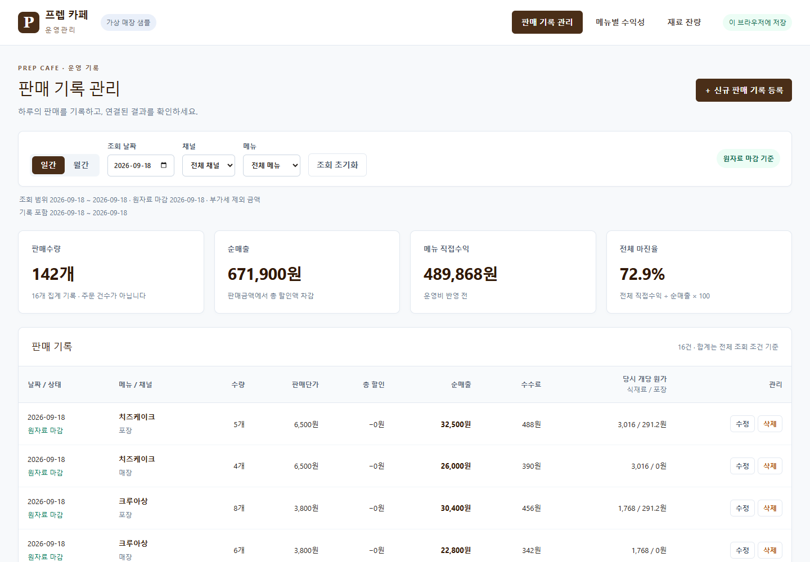
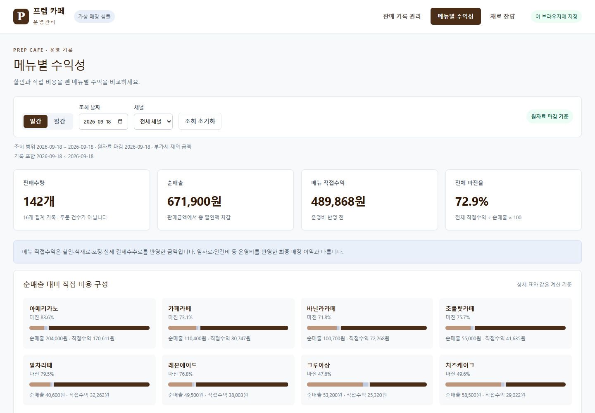

# 프렙 카페 운영 프로그램 테스트 결과

작성일: 2026-10-12  
대상: EPIC 1 — 판매 기록으로 메뉴 수익성과 재료 잔량 확인(Story 1-1~1-5)  
상태: EPIC 1 완료(2026-10-12). 구현·자동 검사 41개 및 사용자 화면 확인 U01~U10을 통과했다. EPIC 2·3은 미착수다.

## 1. 구현 범위와 확인 환경

판매 등록·수정·단일 삭제, 일/월 조회와 메뉴·채널 필터, 메뉴 수익성·비용 구성, 종료일 재료 잔량·재료 검색, 최초 샘플 1회 반영, IndexedDB 지속 저장을 구현했다. React·TypeScript·Vite·Dexie·Zod·decimal.js를 사용하고 설치 버전은 `package-lock.json`에 고정했다.

매장 손익·비용 관리(EPIC 2), 재고 입력·백업·복원(EPIC 3)은 구현하지 않았다. 아직 없는 기능을 가짜 버튼이나 완료 메시지로 제공하지 않는다. 사용자 화면 확인 후 추가 요청에 따라 2026-10-12 GitHub 저장소 https://github.com/hyerish-j/frep.test 의 `codex/epic1` 브랜치에 코드·문서·시안·가상 샘플을 업로드했다. 설치 파일·빌드 결과·브라우저에 저장된 사용자 테스트 기록은 업로드하지 않았다. Vercel 배포는 아직 수행하지 않았다.

사용자 확인 주소: **http://127.0.0.1:5173/#/sales**

실행: 프로젝트 폴더에서 `npm.cmd run dev`. 서버 포트는 5173으로 고정한다. 사용자 확인용 Codex 브라우저를 열었으며, 자동 브라우저 검사는 별도 Chrome 임시 프로필에서 수행해 사용자 확인용 자료를 변경하지 않는다. 실제 사용자 브라우저에서의 확인 결과는 아래 표에 별도로 기록한다.

## 2. 자동 검사 결과

| 검사 | 결과 | 확인한 내용 |
| --- | --- | --- |
| TypeScript 타입 검사 | 통과 | 입력·기록·계산 항목 연결 검사 |
| ESLint 검사 | 통과 | 문법·사용하지 않는 코드 등 검사 |
| 계산·업무 기준 검사 | 28개 통과 | 할인·실제 수수료·가격 적용일·포장 조건·당시 원가 유지·전체 매출 기준 마진·반올림·누락·0·음수·재고·실측·기간 |
| IndexedDB 저장 검사 | 8개 통과 | 최초 1회 반영·등록/수정/삭제·재접속·트랜잭션 실패 전체 취소·다른 창 변경·동시 중복·불완전 자료 보호·중복 원자료 보존 |
| 실제 Chrome 화면 검사 | 5개 통과 | 아래 흐름 모두 통과, Chrome 실행 중 처리되지 않은 오류 없음 |
| 배포용 빌드 | 통과 | `npm.cmd run build`, TypeScript 검사 및 `dist` 생성 성공 |

실제 Chrome 화면 검사 항목:

1. 신규 판매 → 메뉴 수익성 → 재료 잔량 → 재접속 → 수량 수정 → 삭제 취소·확정 → 잔량 회복. 미마감 기록 삭제 후 합계를 확정 0으로 표시하지 않는지 확인한다.
2. 빈 입력 안내·판매 집계 중복 차단·입력 취소·월 조회·페이지 이동·재료 검색.
3. 실측 이전 판매 수정 후 실제 센 수량 보존과 당시 차이 재계산.
4. 판매채널 변경 시 원가 확인·취소·확정, 포장 재료 사용량 제거.
5. 초기 화면의 기준값, 좁은 화면 입력 접근, 외부 서비스 요청 없음.

자동 검사는 사용자의 직접 확인을 대신하지 않는다. 자동 검사에 사용한 임시 프로필과 사용자 확인용 브라우저의 저장 자료는 분리되어 있다.

### 독립적으로 대조한 제공 자료 기준값

앱의 계산 함수를 재사용하지 않고 Python Decimal로 원자료를 별도 계산하여 대조했다.

| 2026-09-18 기준 | 예상값 | 앱·자동 검사 결과 |
| --- | ---: | --- |
| 판매 집계 기록 수 | 16건 | 일치 |
| 판매수량 | 142개 | 일치 |
| 순매출 | 671,900원 | 일치 |
| 직접수익, 반올림 전 | 489,868.32원 | 일치 |
| 직접수익, 표시 | 489,868원 | 일치 |
| 원두 I01 종료 잔량 | 4,280g | 일치 |
| 포장세트 I10 종료 잔량 | 214개 | 일치 |

제공 자료 6,112개 판매 전체와 재고 계산의 연결을 검사했다. 계산 검사 환경에서 전체 자료 수익성·재고 계산이 1초 이내인지 검사하여 통과했다. TRD의 최초 로딩·재접속·파일 처리 목표 전체를 측정 완료했다는 뜻은 아니며 백업/복원 속도는 EPIC 3에서 검사한다.

### 발견 및 수정 기록

| 문제 | 조치 | 재검사 |
| --- | --- | --- |
| 빈 수량·수수료 입력에서 숫자 계산 도구의 기술 오류가 표시됨 | 빈칸 검사 후 숫자 계산을 수행하도록 보완, 항목별 쉬운 안내 표시 | 자동 계산·Chrome 입력 오류 검사 통과 |
| 수량 수정 테스트의 예상 직접수익을 37,741원으로 잘못 기록 | 독립 계산 37,741.6원과 승인된 반올림에 맞춰 예상 표시값을 37,742원으로 정정. 계산 기준은 변경하지 않음 | Chrome 수정 결과 검사 통과 |
| 큰 금액 표시 시 숫자 변환으로 정밀도를 잃을 가능성 | 십진수 문자열을 반올림하고 쉼표를 붙이는 방식으로 표시 | 큰 금액·양수/음수 반올림 검사 통과 |
| 미마감 날짜의 판매가 모두 삭제된 경우 수익성 표 합계의 일부 비용이 0으로 표시됨 | 미마감·미입력 합계도 ‘기록 없음’으로 구분 | 최종 Chrome 삭제 후 표 합계 검사 통과 |

## 3. 사용자 화면 확인 — 한 번에 한 항목씩

현재 사용자 확인용 브라우저는 제공 자료의 판매 화면으로 열었다. 아래 순서대로 **한 항목을 안내하고 사용자의 응답을 받은 뒤** 다음 항목을 안내한다. 응답이 없는 항목을 통과 처리하지 않는다. 문제가 보고되면 증상·수정·재확인 결과를 기록한다.

| 번호 | 확인할 행동 | 예상 결과 | 사용자 결과 |
| --- | --- | --- | --- |
| U01 초기 화면 | 판매 화면에서 조회 날짜 2026-09-18의 요약과 목록을 확인한다. | 가상 샘플 표시, 판매 142개·16건, 순매출 671,900원, 메뉴 직접수익 489,868원. 실제 기록이 있고 오류 화면이 아니다. | 통과 — 사용자 “맞아 확인했어” |
| U02 신규 판매 등록 | 판매 날짜 2026-09-19, 아메리카노, 포장, 10개, 단가 4,000원, 총 할인 2,000원, 수수료 300원을 등록하고 해당 날짜를 조회한다. | 실제 저장 안내, 판매 한 건·순매출 38,000원. 개당 식재료 496.8원·포장 166.4원. 새 날짜는 잠정 표시. 현재 기간 밖이면 조회 조건 안내. | 통과 — 사용자 “응 이렇게 보여” |
| U03 수익성 연결 | 같은 날짜의 메뉴별 수익성에서 아메리카노를 확인한다. | 수량 10개·순매출 38,000원·식재료 4,968원·포장 1,664원·수수료 300원·직접수익 31,068원·마진율 81.8%. 기록 없는 다른 메뉴는 확정 0으로 채우지 않음. | 통과 — 사용자 “응~” |
| U04 잔량 연결 | 같은 날짜의 재료 잔량에서 원두와 포장세트를 확인한다. | 원두 4,080g, 포장세트 204개. 판매 전 기준보다 원두 200g·포장 10개 감소. 이름/번호 검색 가능. | 통과 — 사용자 “응 이렇게 보여” |
| U05 지속 저장 | 브라우저를 새로고침하고 같은 판매 기록을 확인한다. | 조회 시작일 2026-09-19, 저장한 판매 한 건과 연결된 계산 결과 유지. 샘플이 중복 반영되지 않음. | 통과 — 사용자 “그대로있어” |
| U06 잘못된 입력 처리 | 같은 날짜·메뉴·채널로 판매를 추가하려 한다. 별도 입력에서는 수수료를 비워 등록하려 한다. | 집계 중복은 기존 수정 안내로 차단. 빈 수수료는 해당 항목을 안내하고 입력을 유지. 새 기록이 생기지 않음. 입력 취소 시 미저장 내용 확인. | 통과 — 중복 안내 및 빈 수수료 차단을 사용자 확인 |
| U07 판매 수정 | U02에서 등록한 판매수량을 10개에서 12개로 바꾸고 저장한다. | 같은 ID의 한 건 수정. 순매출 46,000원·직접수익 37,742원(반올림 전 37,741.6원). 개당 원가 유지. 원두 4,040g·포장 202개. | 통과 — 판매 목록·메뉴 수익성·재료 잔량 변경을 사용자 확인 |
| U08 삭제 취소 | 해당 판매의 삭제를 누른 뒤 확인창에서 취소한다. | 판매 한 건과 수량·매출·수익·잔량이 그대로 유지. | 통과 — 사용자 “네”, 판매 한 건·수량 12개·순매출 46,000원 유지 확인 |
| U09 판매 삭제 확정 | 해당 판매 한 건의 삭제를 확정하고 잔량·새로고침 후 기록을 확인한다. | 판매 제거, 원두 4,280g·포장 214개로 회복. 미마감 9월 19일의 판매·수익성은 ‘기록 없음’으로 표시하며 삭제 상태 유지. | 통과 — 판매 삭제·잔량 회복·수익성 반영·새로고침 후 삭제 유지를 사용자 확인 |
| U10 조회·필터 | 월간 2026-09 조회, 판매 메뉴/채널 필터, 페이지 이동, 재료 이름/번호 검색을 확인한다. | 월 전체 조회 조건의 합계 유지, 페이지는 목록만 변경. 채널·메뉴 변경에 맞는 기록만 표시. 없는 재료 검색은 검색 결과 없음으로 표시. | 통과 — 월간 합계·메뉴/채널 필터·페이지 이동 및 합계 유지·재료 이름/번호 검색·검색 결과 없음 안내를 사용자 확인 |

수익·잔량 예상값은 다른 자료를 추가로 변경하지 않은 제공 샘플과 위 테스트 판매를 기준으로 한다. 사용자가 다른 값을 입력하거나 기존 샘플을 수정한 경우 그 차이를 먼저 확인하고 기대값을 다시 계산한다. 가상 테스트 입력을 실제 매장 기록으로 설명하지 않는다.

실측 이전 수정의 경계 사례·원가 재확인 취소·저장 실패 전체 취소 등은 자동 검사에서 확인했다. 사용자에게는 위 핵심 흐름을 순차 안내하며 추가 증상이나 확인 필요 사항이 있으면 별도 항목으로 기록한다.

## 4. EPIC 완료 판정

| EPIC | 자동 검사 | 사용자 확인 | 최종 상태 |
| --- | --- | --- | --- |
| EPIC 1 | 41개 통과, 타입/문법/빌드 통과 | U01~U10 모두 통과(2026-10-12) | 완료 |
| EPIC 2 | 미실시 | 미실시 | 미착수 |
| EPIC 3 | 미실시 | 미실시 | 미착수 |

2026-10-12 사용자가 U01~U10을 문제없이 확인하여 `docs/04_개발계획.md`의 EPIC 1만 완료로 변경했다. EPIC 2·3은 미착수로 유지한다.

## 5. 사용자 응답 기록

| 날짜 | 항목 | 사용자의 확인 내용 | 판정·후속 조치 |
| --- | --- | --- | --- |
| 2026-10-12 | U01 초기 화면 | “맞아 확인했어” — 안내한 날짜와 판매수량·순매출·직접수익 확인 | 통과. U02 신규 판매 등록 안내. EPIC 1은 계속 사용자 확인 대기 |
| 2026-10-12 | U02 신규 판매 등록 | “응 이렇게 보여” — 안내한 판매 한 건·순매출 38,000원·잠정 표시 확인 | 통과. U03 메뉴 수익성 연결 안내. EPIC 1은 계속 사용자 확인 대기 |
| 2026-10-12 | U03 수익성 연결 | “응~” — 판매 10개·순매출 38,000원·직접수익 31,068원·마진율 81.8% 확인 | 통과. U04 재료 잔량 연결 안내. EPIC 1은 계속 사용자 확인 대기 |
| 2026-10-12 | U04 잔량 연결 | “응 이렇게 보여” — 원두 4,080g·포장세트 204개 확인 | 통과. U05 지속 저장 안내. EPIC 1은 계속 사용자 확인 대기 |
| 2026-10-12 | U05 지속 저장 | “그대로있어” — 새로고침 후 판매 기록 유지 확인 | 통과. U06 중복 등록 확인 안내. EPIC 1은 계속 사용자 확인 대기 |
| 2026-10-12 | U06 중복 등록 차단 | “네 안내보여요” — 같은 날짜·메뉴·채널의 중복 등록 안내 확인 | 이 부분 통과. U06 빈 수수료 확인 안내. EPIC 1은 계속 사용자 확인 대기 |
| 2026-10-12 | U06 빈 수수료 차단 | “응” — 수수료 입력 안내·입력창 유지·저장 차단 확인 | U06 입력 검사 통과. U07 판매 수정 안내. EPIC 1은 계속 사용자 확인 대기 |
| 2026-10-12 | U07 판매 목록 수정 | “네” — 수량 12개·순매출 46,000원·기록 한 건 확인 | 목록 수정 부분 통과. 수정 후 메뉴 수익성 안내. EPIC 1은 계속 사용자 확인 대기 |
| 2026-10-12 | U07 수정 후 메뉴 수익성 | “네” — 수량 12개·순매출 46,000원·직접수익 37,742원 확인 | 수익성 연결 통과. 수정 후 재료 잔량 안내. EPIC 1은 계속 사용자 확인 대기 |
| 2026-10-12 | U07 수정 후 재료 잔량 | “네” — 원두 4,040g·포장세트 202개 확인 | U07 판매 수정 연결 통과. U08 삭제 취소 안내. EPIC 1은 계속 사용자 확인 대기 |
| 2026-10-12 | U08 삭제 취소 | “네” — 삭제 취소 후 판매 한 건·수량 12개·순매출 46,000원 유지 확인 | 통과. U09 판매 삭제 확정 안내. EPIC 1은 계속 사용자 확인 대기 |
| 2026-10-12 | U09 판매 목록 삭제 | “응” — 2026-09-19 판매 기록 삭제 및 ‘기록 없음’ 확인 | 판매 목록 삭제 부분 통과. 재료 잔량 회복 안내. EPIC 1은 계속 사용자 확인 대기 |
| 2026-10-12 | U09 삭제 후 재료 잔량 | “응” — 원두 4,280g·포장세트 214개로 회복 확인 | 잔량 회복 부분 통과. 삭제 후 메뉴 수익성 안내. EPIC 1은 계속 사용자 확인 대기 |
| 2026-10-12 | U09 삭제 후 메뉴 수익성 | “dmd” — 한글 자판의 “응”으로 해석. 2026-09-19 삭제한 아메리카노의 판매·수익 ‘기록 없음’ 확인 | 수익성 반영 부분 통과. 새로고침 후 삭제 유지 안내. EPIC 1은 계속 사용자 확인 대기 |
| 2026-10-12 | U09 새로고침 후 삭제 유지 | “응” — 새로고침 후 2026-09-19 판매 기록이 다시 나타나지 않고 ‘기록 없음’ 유지 확인 | U09 통과. U10 월간 조회 안내. EPIC 1은 계속 사용자 확인 대기 |
| 2026-10-12 | U10 월간 조회 | “그런거같아” — 월간 화면이 보인다는 잠정 응답 | 확정 통과로 처리하지 않고 원자료 월 합계와 대조할 값 안내. EPIC 1은 계속 사용자 확인 대기 |
| 2026-10-12 | U10 월간 합계 대조 | “응” — 2026-09 전체 판매수량 2,956개·순매출 13,968,930원·메뉴 직접수익 10,212,723원 일치 확인 | 월간 합계 부분 통과. 메뉴·채널 필터 안내. EPIC 1은 계속 사용자 확인 대기 |
| 2026-10-12 | U10 메뉴·채널 필터 | “응” — 2026-09 아메리카노·포장 기록만 표시, 판매수량 517개·순매출 2,056,000원 확인 | 필터 부분 통과. 페이지 이동 안내. EPIC 1은 계속 사용자 확인 대기 |
| 2026-10-12 | U10 다음 페이지 목록 | “목록은 어떻게 바꿔?”에 전체 메뉴·전체 채널 선택 후 목록 아래 다음 버튼을 안내. 이어 “응” — 21–40 / 256건 표시 확인 | 페이지 목록 변경 부분 통과. 페이지 이동 후 합계 유지 확인 안내. EPIC 1은 계속 사용자 확인 대기 |
| 2026-10-12 | U10 페이지 이동 후 합계 유지 | “응” — 다음 페이지에서도 판매수량 2,956개·순매출 13,968,930원 유지 확인 | 페이지 이동 검사 통과. 재료 검색 안내. EPIC 1은 계속 사용자 확인 대기 |
| 2026-10-12 | U10 재료 이름 검색 | “응” — 재료 검색에 원두 입력 시 원두(I01) 한 행만 표시 확인 | 재료 이름 검색 통과. 없는 재료 검색 안내. EPIC 1은 계속 사용자 확인 대기 |
| 2026-10-12 | U10 없는 재료 검색 | “응” — 없는재료 검색 시 빈 목록과 ‘검색 결과 없음 · 재고가 0이라는 뜻이 아닙니다.’ 안내 확인 | 검색 결과 없음 안내 통과. 마지막 재료 번호 검색 안내. EPIC 1은 계속 사용자 확인 대기 |
| 2026-10-12 | U10 재료 번호 검색 | “응” — I10 검색 시 포장세트(I10) 한 행만 표시 확인 | U10 통과. 사용자 화면 확인 U01~U10이 모두 통과하여 EPIC 1만 완료로 표시 |

## 6. 화면 증거

자동 Chrome 검사에서 제공 샘플 초기 상태를 캡처했다. 사용자 확인용 브라우저 화면에서도 동일한 초기 요약을 확인했으며 사용자 응답을 대신하는 증거로 사용하지 않는다.

